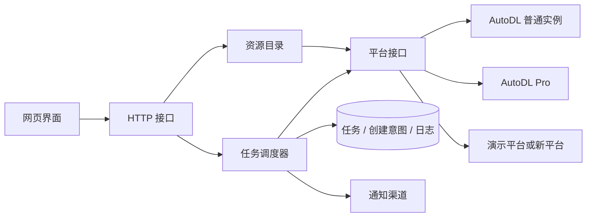

# 架构与扩展

## 模块边界

`models.py` 只描述业务数据，不依赖 HTTP、SQLite 或 AutoDL。`scheduler.py` 通过 `Provider` 协议调用库存、报价、创建和核对能力；具体平台的字段、端点和登录策略放在 `providers/`。`app.py` 只负责依赖装配、输入检查与返回状态。前端的表单与 HTTP 客户端单独拆分，便于将来迁移到 React 或其他框架。

## 状态与创建一致性

任务状态包括未开始、运行中、暂停、需要关注和已完成。每条规则具有独立编号、每实例卡数及目标实例数，实例按规则编号关联。

单任务创建串行执行。每次创建都先提交唯一名称的 `pending` 意图；收到明确实例编号后，将实例结果和意图成功状态放在同一 SQLite 事务提交。明确库存不足可以下轮重试；无法判断平台是否接收的异常会保留意图并暂停，必须核对后再继续。

进程崩溃后不能仅凭“实例列表暂时没有记录”推断请求失败，因为平台可能延迟展示，也可能已生成未支付订单。自动核对只确认已找到的实例；未找到时保留待核对状态。用户确认未创建属于显式操作，留有日志。

暂停不会取消已发送的创建或支付请求。它会中断下一次等待，并在报价完成后再次检查停止信号，防止停止期间发出新请求。相同任务不能同时启动两个工作协程；数据目录文件锁防止多个进程调度同一份数据。

## 新增平台

1. 在 `providers/` 新建适配器，实现 `Provider`：`catalog`、`quote`、`create`、`find_instance`。`validate` 用于启动前校验登录及平台限制。
2. 返回标准 `Catalog`、`Quote` 和 `Instance`。金额统一为人民币元，报价统一为每卡每小时与每实例磁盘每小时。平台单位换算只发生在适配器内。
3. 按实际后果抛出错误：需要登录用 `AuthenticationError`，不支持或字段变化用 `UnsupportedError`，明确无库存用 `OutOfStock`，可能已创建用 `UncertainCreation`。普通 `ProviderError` 会按上限 300 秒退避重试。
4. 在 `app.py` 生命周期装配中注册适配器。前端平台列表来自后端，通用规则无需另写。
5. 若新平台有额外配置，应扩展业务契约和规则表单，明确单位与默认行为，不向创建接口透传任意用户 JSON。
6. 使用模拟响应验证请求字段、价格校验和异常核对。先完成只读联调，再验证创建路径。

## 替换通知渠道

`Notifier.success` 在结果已持久化后调用。新增渠道应接受明确的事件与实例摘要，失败时记录日志，不回滚或重试创建。短信、邮件、Webhook 可以作为独立渠道实现，再由通知服务按偏好分发。

网页语音依赖打开的页面；Windows 原生 Toast 由后端发送，因此网页关闭时仍能提醒。前端只在后端不支持原生通知时发送浏览器通知，避免同一页面收到双份通知。

## 登录浏览器边界

`browser_launcher.py` 负责发现本机浏览器和启动专用窗口；此阶段不启动浏览器驱动，供用户自行完成登录及安全认证。`browser_session.py` 只在用户点击确认后连接该专用窗口、捕获官网请求头并进行只读校验。`autodl_response.py` 统一解释平台响应；`transport.py` 保留官方开发者 API 客户端。

浏览器配置按 Chrome、Edge 分目录存放，不与日常浏览器共用。程序的连接端口只绑定本机，连接参数文件只保存端口号。服务重启可重新找到专用窗口，服务退出只断开工具连接。运行中的监控任务或在途创建请求会阻止切换登录浏览器，避免请求中途更换账号。

## 资源筛选与收藏

`Catalog.regions` 保留物理地区选项，兼容已经保存的监控规则；新增 `region_groups` 将同一数据中心的物理地区聚合为界面按钮。资源区选择的数据中心会先展开成对应的物理地区列表，再查询库存与主机，不能使用空地区列表代替全部地区。

`Provider.resources` 提供平台无关的只读资源页。普通实例从主机列表和价格预览返回账号报价，Pro 返回规格池信息。输出只包含型号、主机编号、规格和价格等展示字段，不透传平台原始响应。前端只在选中型号后读取详情，地区切换和快速选择通过请求版本号防止旧响应覆盖新界面。

目录缓存按平台、地区和网页登录修订号隔离，连接状态改变后刷新资源。收藏使用 `(provider, gpu_id)` 唯一键，与任务和创建意图分开；增加、取消收藏不会改变任务配置。前端控制逻辑集中在 `web/js/resources.js`，主视图只负责装配和提供登录、配置回调。

## 任务管理与账号实例

`Task.action` 区分 `create` 和 `start`，旧任务默认 `create`。创建规则保存在 `rules`，已有实例目标保存在 `start_targets`，两者互斥。已有实例配置由服务端从账号列表解析，客户端只提交选中的实例编号，不能透传任意开机参数。

`providers/account_instances.py` 集中映射普通网页与 Pro 官方 API 的实例列表和开关机接口。`AccountInstance` 只输出展示字段及可操作状态，不包含 SSH 密码、访问 Token 或完整平台响应。`Provider.selected_instances` 按页查找账号拥有的目标，确保批量选择不依赖当前一页。

`instance_monitor.py` 负责有卡开机状态机，与新建实例库存及报价分开。每个目标发送前先记录 `pending` 意图；明确无库存结束本次意图，下轮可重试；收到成功响应后保留意图，只查询状态。仅在 `running` 且 `start_mode=gpu` 时提交结果并通知。超时保留意图；恢复时先查询，避免重复发送。平台三分钟仍显示可启动状态时进入待核对，长时间 `starting` 则继续观察。无卡运行、账号目标消失或配置发生变化会要求用户关注。

编辑、删除、启动、核对和关机通过调度器控制锁串行协调。编辑删除须等待工作协程结束并处理所有待核对记录，防止旧协程将删除的任务重新写回。编辑保留已完成结果；删除保留日志与请求记录。关机先停止相关开机任务，等待其在途请求完成，再发送关机，避免后台监控随后将实例重新开机。

前端 `instances.js` 管理账号列表与操作，`rules.js` 复用新建及修改表单，并在修改时保留规则编号。事件增加 `subject` 字段用于 GPU 型号高亮；启动时为旧数据库补列，不删除历史记录。所有型号和日志内容转义后渲染。

## 存储与多进程演进

当前 SQLite 写操作位于同一事件循环，事务短小，不跨网络等待。Windows 和服务器都使用同一业务层，差异集中在配置、浏览器运行环境和通知能力。

需要多进程、多账号或多用户时，应先引入任务所有权和账号标识，再迁移到 PostgreSQL 与队列。将创建意图的唯一约束、数据库事务及结果核对保留在存储层，调度租约需支持过期恢复。浏览器会话应由独立工作进程持有，不能在多个 Web 工作进程之间共享。

不要通过增加 Uvicorn 工作进程数扩展现有调度器。当前文件锁会拒绝同一目录的第二个服务，避免重复创建。

## 数据与维护

所有运行数据都在 `CATCHGPU_DATA_DIR`，默认 `data/`。日志目前不自动清理，界面保留最近 200 条，数据库保存历史记录；长期部署应根据保留周期增加归档任务。目录缓存 60 秒，任务每轮独立获取库存和价格，不使用目录缓存创建实例。

原始平台响应、Token、Cookie、SSH 密码和 Jupyter 凭据不写入日志。异常保留平台错误代码或内部异常类型，业务错误集中分类；后续如增加调试日志，应继续通过脱敏层处理。
